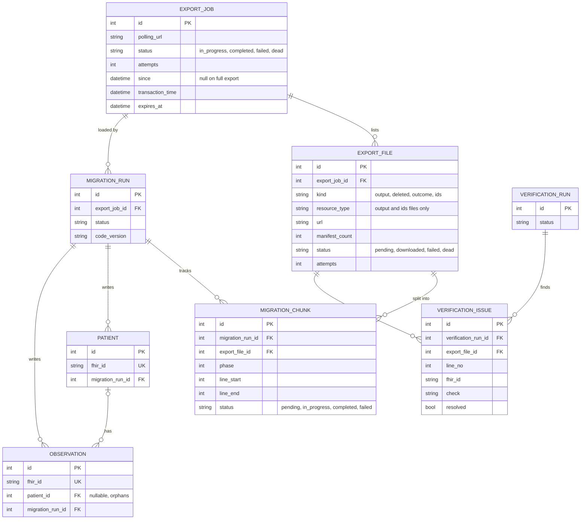
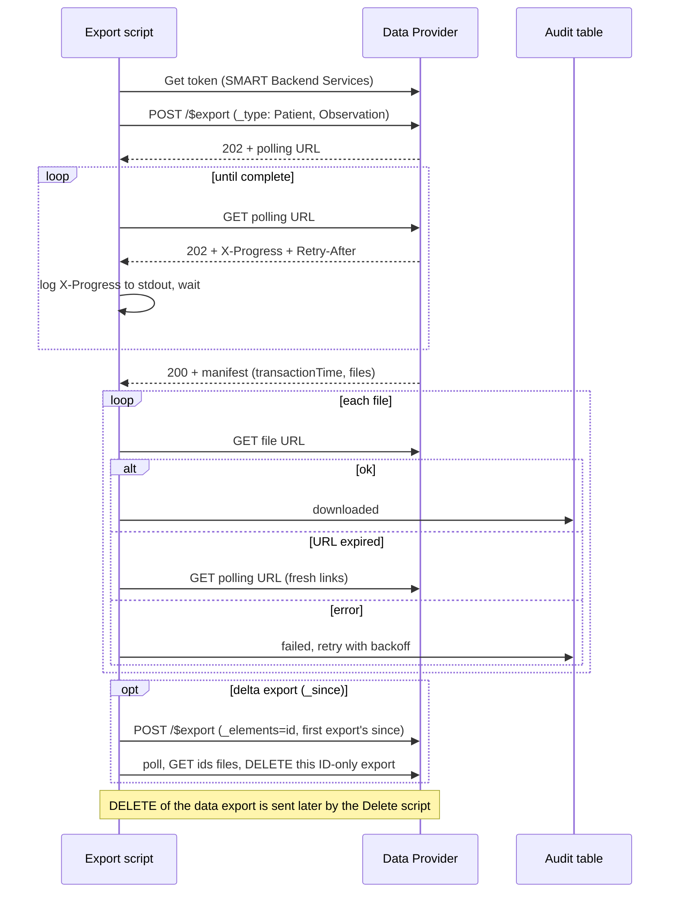
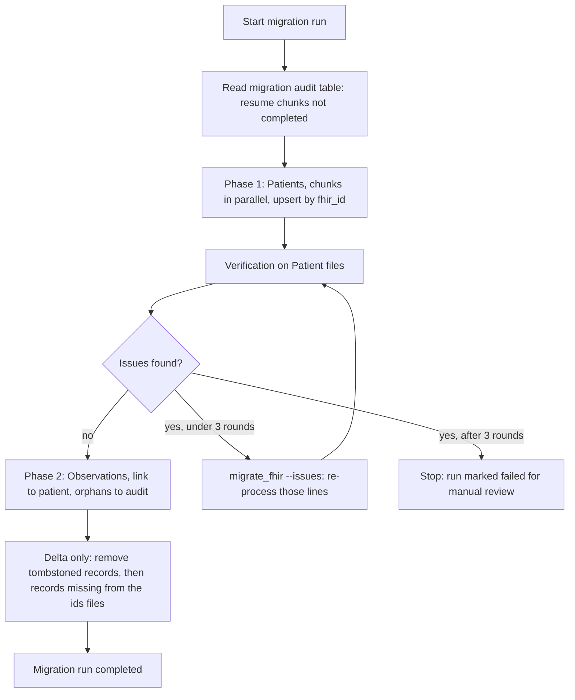
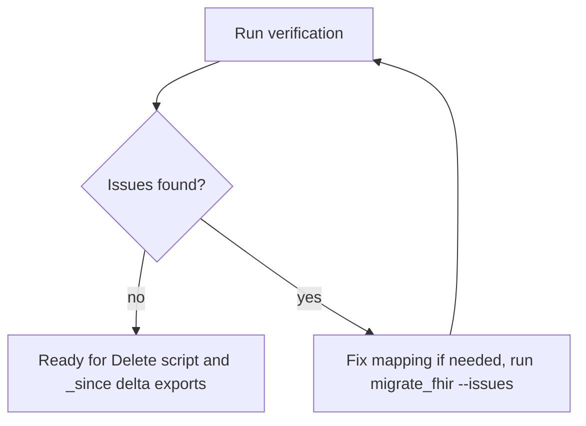

# Migration Plan

## Overall approach

We will create four Django scripts:

- **Export:** to request, poll, download, and handle failures of FHIR file exports.
- **Migration:** to load the NDJSON files into the database.
- **Verification:** to check the result and list what needs a retry.
- **Delete:** to delete the exported files in the Data Provider and Data Consumer.

### Export Script

- **Export:** we will use `POST /$export` with `_type` set to Patient and Observation to export it to NDJSON format. Each type is sent as its own `_type` parameter, as the IG requires (never comma-delimited).
- **Export failure:** the export request is retried with exponential backoff up to a maximum number of attempts, then marked `dead` in the audit table. A `dead` export can be retried by re-running the script manually.
- **Progress status follow-up:** then we will poll the status URL with exponential backoff, waiting at least the `Retry-After` time sent by the server. Each poll logs `X-Progress` to stdout.
- **Download:** the manifest may list several files per resource type. Each file (`output` data, `deleted` tombstones and `outcome` messages) is downloaded and tracked on its own in an audit table, with its resource type.
- **Expired download links:** if the files' URLs have expired (announced by the `Expires` header), we poll the status URL again to get a fresh manifest.
- **Download failure:** the file is retried with exponential backoff up to a maximum number of attempts. If it still fails, we re-fetch the manifest (the URL may have expired) and try once more. If that fails too, we request a new export for that file's resource type (e.g. `_type=Observation`), which counts as an export attempt and follows the Export failure rule above.
- **Transaction Time:** we save the manifest's `transactionTime`. If the legacy system keeps receiving writes during the migration, a follow-up export with `_since=<transactionTime>` brings only what changed after the first export. Its `deleted` files list resources removed from the source in the meantime, which we remove locally (the first full export has no `_since`, so it has no `deleted` files). The Data Provider may omit `deleted` even with `_since`, so every delta export also runs, automatically, an ID-only export (`_elements=id`): the ids of everything the source still has, with the first export's `since` so the list is complete. It runs after the data export, so nothing that export brought is missing from the list, and it is `DELETE`d on the server as soon as its files are downloaded. The migration then removes local records whose `fhir_id` isn't in the list. It only deletes, never inserts or updates, and refuses when the list is empty or would delete more than 10% of a table, since that more likely means a broken export. Each export job stores its `since` (what we asked for) and `transactionTime` (what the provider returned), so one job's `transactionTime` becomes the next one's `since`. `since` is always taken from the previous job, never typed by hand, since one that's too late would silently skip every change in the gap. Re-running the script resumes an unfinished export, and a new export only starts once the latest one has finished downloading, so the chain has no gaps. We repeat this until the delta is small enough for cutover.

### Migration Script

- **NDJSON Reading and Mapping:** read each NDJSON file line by line, map each line to an object and upsert it by FHIR id (`fhir_id`). Keying on the source id (it makes re-runs safe). The exception is resources tagged `SUBSETTED` (incomplete, per the IG): they are only inserted when new and never overwrite an existing record.
- **Audit:** every row stores the `migration_run_id` of the run that wrote it. And every migration stores its trace on the migration audit table (pending, in progress, completed, and so on). A bad line doesn't stop its chunk: it is skipped, the chunk is marked failed, and the verification catches the missing rows.
- **Phases:**
  - Phase 1 migrates patients.
  - Phase 2 starts only after the patients pass verification, so every observation can be linked to its patient. The fix-and-verify loop runs at most 3 rounds; if issues remain, the run stops and is marked failed for manual review (usually bad data that needs a mapping fix). Observations whose subject isn't found keep a null patient FK, store the original `subject_reference`, and are logged in the audit table. Once a missing patient is fixed, re-processing its orphan observations (`--issues`) links them.
- **Parallelism:** each line is a full record, so files are split into chunks processed in parallel.

### Verification Script

- **Validation:** runs the validation steps, comparing the NDJSON files with the database.
- **Audit:** each run gets a `verification_run_id`, and every problem found is stored in a `verification_issue` table (file, line, `fhir_id`, check, resolved).
- **Use Case:**
  - **During migration:** as Observation depends on Patient migration, the Migration Script runs the verification for the Patient NDJSON files to make sure that the migration was successfully done before running the Observation migration (Phase 2).
  - **On demand:** issues can be fixed by running the migration with that run ID (for example: `migrate_fhir --issues <verification_run_id>`), which re-processes only those lines and marks the status. A new verification run can then confirm the fix.

### Delete Script

- After the migration succeeds, this script can be run to send a `DELETE` request to the FHIR server to delete the exported data files and delete our downloaded copy, keeping user data secure.
- After the `DELETE`, the polling URL returns 404 and the manifest can no longer be re-fetched, so it only runs when no further retries are needed. Each `_since` export is a separate job and needs its own `DELETE`.

## Validation

- After each batch, compare the audit table with the NDJSON file, line by line.
- Per file, the manifest `count` must match the lines read and the rows upserted.
- Read the manifest's `outcome` files: a partial success still returns HTTP 200, so errors only show up there.
- Count observations with no patient FK (orphans); each must be explained by a non-Patient subject or a patient logged as missing.

## Data mapping

| Patient | FHIR source |
|---|---|
| `fhir_id` (unique) | `id` |
| `mrn` (nullable) | `identifier.where(type.coding.code = 'MR').value` |
| `family_name`, `given_names` | `name` (`use = official`) |
| `gender`, `birth_date` (nullable), `active` | same names |
| `managing_org_ref` | `managingOrganization.reference` |

| Observation | FHIR source |
|---|---|
| `fhir_id` (unique) | `id` |
| `patient` (FK, nullable), `subject_reference` | `subject.reference` |
| `status` | `status` |
| `code_system`, `code`, `code_display` | `code.coding[0]` (e.g. LOINC) |
| `effective_at`, `issued_at` | `effectiveDateTime`, `issued` |
| `value_quantity` | `valueQuantity`, kept as is |
| `interpretation_code` | `interpretation[0].coding[0].code` |
| `ref_low`, `ref_high` | `referenceRange[0].low/high.value` |
| `performer_ref` | `performer[0].reference` |

Both tables also store `migration_run_id` and `source_file`.

## Security

- TLS 1.2 or newer for data in transit, and encryption at rest for the local NDJSON files and the database.
- SMART Backend Services (JWT + OAuth 2.0) for authentication, re-authenticating when the short-lived token expires on long runs.
- Once all files are downloaded and validation passes, send `DELETE` to the polling URL so the Data Provider removes the export, and delete the local NDJSON files.

## Rollback

- The migration script is re-runnable: data is upserted, so partial inserts are fixed by running it again.
- `migration_run_id` lets us find and remove the rows written by a bad run.
- The audit table shows what failed. The migration script resumes from its own status in the migration audit table and retries the failed parts in parallel.

## Diagrams

### Database schema

The audit tables behind the three scripts, and how they link to the migrated data (Patient and Observation columns are in Data mapping).

### Export flow

How the export script requests the export, polls its status, and downloads each file.

### Migration flow

How the migration script resumes, migrates patients, checks them before observations, and migrates observations.

### On-demand verification

Run manually at any time, independently of the migration, to confirm the data before cutover.

